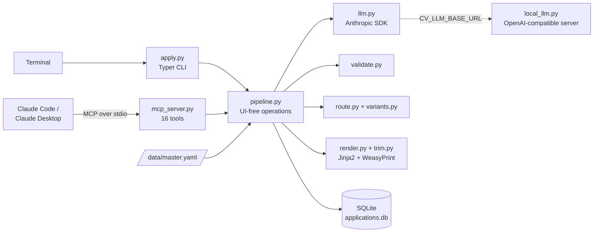

# CV Tailor: design

This document explains how CV Tailor is built and why. For setup and day-to-day use, see the [README](../README.md).

## The problem

Applying to many job postings means tailoring a CV each time: picking the summary, the bullets and the skills that best fit the posting, in English or Brazilian Portuguese, on one page. An LLM is good at that judgment. It is also good at quietly inventing experience, inflating numbers and drifting in wording, which is unacceptable on a CV.

## The core rule

**CV text comes only from human-verified sources. The model selects and orders ids; it never writes CV text.**

Everything else follows from this rule:

- The master resume (`data/master.yaml`) is the only source of CV text. Every summary, bullet, project and skill category has an id, tags, and an `en` and `pt` text written by the user.
- The selection model receives an index of ids with their English text and returns ids only. Its output schema is built from the master, so every id field is an enum of ids that really exist.
- The template never sees model output. It receives a `RenderInput` (master, validated selection, language, i18n strings) and nothing else. Suggestions, unmatched requirements, job tags and meta fields aren't part of that model, so they can't leak into the PDF by mistake.
- Tests check this with sentinel strings, and extract the text of rendered PDFs to check that every line traces back to the master or the i18n file.

## Architecture

The CLI and the MCP server are two thin front ends over the same pipeline. `pipeline.py` holds the `new`, `render`, `regen`, `edit` and `approve` operations. It takes an `IO` object for output and prompts, so the same code prints to a terminal, collects a log for an MCP result, or asks interactive questions only when a terminal is attached.

| Module | Responsibility |
|---|---|
| `schema.py` | Pydantic models for the master, selections, variants and meta |
| `master.py` | Load and validate the master; build the tag vocabulary and the LLM index |
| `tags.py` | Deterministic tag extraction from a job description |
| `llm.py` | Prompts, dynamic schemas, prompt caching, retry with errors |
| `local_llm.py` | Same interface as the Anthropic client, over an OpenAI-compatible server (stdlib only) |
| `validate.py` | Selection rules, reporting every error at once |
| `route.py`, `variants.py` | Scoring against approved variants; variant hashes and states |
| `render.py`, `trim.py` | HTML and PDF rendering; deterministic page fit |
| `editor.py` | Selection editing as annotated YAML |
| `generation.py` | Opt-in drafted wording, gated by item-by-item review |
| `db.py`, `stats.py` | SQLite with numbered migrations; callback rates |

## Pipeline

| Step | Done by | What happens |
|---|---|---|
| 0. Meta | LLM (small call) | Company, role, posting language and URL. The call gets only the job description, never master data. The values name the output folder and file; they never reach the CV content. |
| 1. Tags | Code | Match the master's tag vocabulary and aliases on word boundaries. `c#`, `node.js` and `ci/cd` work; tags under 3 characters only match through an alias. |
| 2. Duplicate check | Code | The same posting (hash) is blocked; the same company and role within 60 days asks for confirmation. |
| 3. Route | Code | Score the job tags against approved variants. Above the threshold, reuse that variant and skip step 4. |
| 4. Select | LLM | Return ids only, as structured JSON. |
| 5. Validate | Code | Check every selection rule. Retry the LLM once with the errors, then stop. |
| 6. Render and fit | Code | Render in the chosen language. If it overflows one page, drop the least relevant items in a fixed order. |
| 7. Log | Code | Write the application row and the PDF in one transaction. |

If any step fails, no row is written and the new output folder is removed.

### Selection with a dynamic schema

The selection schema is generated from the master for each run:

- `summary_id` is an enum of summary ids.
- `bullets` has one required property per job, and each is an array whose items are an enum of **that job's** bullet ids. Project and education bullets work the same way.
- Skill categories are enums per tier, so a category can't move between tiers.

Structured output then makes most invalid answers impossible, and `validate.py` checks the rest: bullet counts per job and in total, project limits, duplicates, and alternatives that exclude each other. A failed selection is retried once with the error list, then rejected. It is never repaired silently, because a repaired selection is a selection nobody chose.

The system prompt and the master index form the cached prompt prefix; only the job description changes between calls. The model also returns `unmatched_requirements` (what the posting asks for that the master doesn't cover) and `suggestions`. Both are shown to the user and stored, and neither can be rendered.

Current Claude models reject sampling parameters, so no temperature is sent. Variance is kept low with low effort, enum-constrained output and validation in code.

### Routing and variants

When a selection works well, `approve` saves it as a named variant. A variant must fit on one page in **both** languages when it is approved. Later postings with similar tags reuse it with no selection call, which is faster, cheaper and makes the result consistent.

The route score combines tag similarity with the variant's approved tags (Jaccard) and the coverage of the job's tags by the selected items. Postings with fewer than 3 tags always generate, because the signal is too weak.

Each variant stores a hash of every selected item's text, which gives it a state:

- `ok`: valid, and the text is unchanged.
- `drifted`: valid, but some text changed since approval. It is still used, with a warning.
- `stale`: it no longer validates against the master, for example because an id was removed or a job was added. It isn't used until it is regenerated and re-approved.

### Page fit

After rendering, the page count is checked. While the CV is over one page, the last bullet is removed from the entry with the most bullets (ties go to the older entry). Jobs keep their minimum number of bullets; project and education lines can go down to none. When no bullet can go, whole projects are removed. Every removal is reported and stored. Trimming only removes content and never changes text, so it can't break the core rule. `--no-trim` turns it into an error.

## MCP server and Claude Code integration

`cvtailor/mcp_server.py` exposes the pipeline as 16 MCP tools (MCP Python SDK 2.x, stdio transport), so Claude Code or Claude Desktop can drive the whole workflow in plain language.

**The core rule holds for the calling model too.** Tools take and return ids, never resume text. `update_selection` is the only way to change a CV from Claude, and it takes a selection of ids, validates it and renders it without trimming. If it is invalid or over one page, nothing changes.

Other decisions:

- **Confirmations are parameters.** The CLI asks interactively before applying twice to the same company, or before logging the same posting twice. Over MCP these become explicit flags (`confirm_same_company`, `allow_duplicate`). The tool fails with a message that tells the model to ask the user, then retry.
- **stdout belongs to the protocol.** Pipeline output is collected and returned in each result's `log` field, never printed.
- **Expected failures become `ToolError`s.** Validation errors, page overflow and a missing renderer reach the model as readable messages it can act on, not tracebacks.
- **Tool annotations.** Read-only tools are marked as such. `regen_application` and `update_selection` are marked destructive, because they replace a stored selection.
- **Server instructions** describe the typical flow and restate the rule: change ids, never text, and pass the user's review replies verbatim.
- **No promotion tool.** Approved drafts that make new claims can only be promoted to CV content from a terminal, so a model can never move its own claims into a CV (see below).

The repository also ships the Claude Code side:

- `.mcp.json` registers the server for the project.
- `CLAUDE.md` gives Claude the project rules and conventions.
- `.claude/skills/tailor/SKILL.md` adds a `/tailor` command: paste a posting or give a file, run `tailor_cv`, handle the expected failures by asking the user instead of guessing, report the result, and offer next steps (other language, approve a variant, adjust ids).

## Opt-in drafted wording

Sometimes the right words aren't in the master: a bullet would match the posting better with the posting's vocabulary, or two bullets would read better as one. This feature lets a model draft wording without breaking the core rule. It is off by default (`CV_ALLOW_GENERATION=false`) and lives in one module, `generation.py`.

1. The model drafts at most 5 items, each in EN and PT, with the ids it is based on and a rationale. A draft is a `rephrase` of one item, a `merge` of 2 or 3 bullets of the same job, or a `new` claim.
2. Code checks each draft. A **number guard** reclassifies any rephrase or merge that contains a number missing from its sources as `new`.
3. The user reviews each draft: `y` approves that exact text; `y, <comment>` asks for a revision, which is shown again and never stored directly; `n` rejects it, and `n, <comment>` also keeps the comment as feedback for later drafts.

Where approved text goes sets its trust level:

| Source | Holds | Rendered? |
|---|---|---|
| `data/master.yaml` | Text the user wrote | Yes |
| `facts` table | Approved rephrases and merges | Yes. Selectable like master items, and never alongside the items they reword |
| `unsafe_items` table | Approved new claims | No. Only `apply.py unsafe promote <id>`, run by the user in a terminal, can move one to `facts` |

Every draft, reply and comment is also kept in a `proposals` table as an audit trail.

## Data model

SQLite, with numbered migrations tracked by `PRAGMA user_version`.

- `applications`: one row per application, holding the posting, tags, route and score, the selection exactly as rendered, the raw model selection, trimmed ids, token usage (including cache reads and writes), the PDF path and the status.
- `status_history`: every status change. `furthest_stage` only ever increases, so an application that reached an interview and was then rejected still counts as an interview in the stats.
- `proposals`, `facts`, `unsafe_items`: drafted wording (see above).

`stats` reports screen and interview rates by variant, language and route. It excludes discarded applications and those too recent to judge, shows `n` next to every rate, and flags groups under 10 as a low sample.

## Master format

See [examples/master.example.yaml](../examples/master.example.yaml) for a full example with fictional data. Besides summaries, jobs, projects, skills and education, the format supports what a designed one-page CV needs: a headline, labeled links, context lines above bullets, the section order, and **validated alternatives**. An item can carry `alt_of: <id>` to mark it as another version of an existing item. The selector picks the version that fits the posting and never both.

`validate-master` checks the whole file and reports every error at once: unique ids, both languages present, valid tags and dates, consistent limits, and valid `alt_of` links. It also checks every saved variant against the current master.

## Local models

Setting `CV_LLM_BASE_URL` sends every call to an OpenAI-compatible server (Ollama, llama.cpp, LM Studio) instead of the Anthropic API. `LocalClient` mimics the part of the Anthropic client the code uses, so prompts, schemas, validation and retries are shared by both backends. Local servers enforce the schema with grammar-constrained decoding and accept array-length keywords that the Anthropic API rejects, so for local models the schema also carries the per-entry bullet limits. Prompt caching and the effort setting are Anthropic-only.

## Testing

- The LLM is replaced by a fake client in every test, except one integration test that runs only with `CV_INTEGRATION=1`.
- Each master validation rule has a passing and a failing fixture.
- Selection validation, routing, variant states, page fit, duplicate checks, stats and the editor each have their own tests.
- MCP tools are tested through the server, including the error paths.
- The trust boundary is tested directly: sentinel strings placed in suggestions, unmatched requirements, company and role must never appear in the rendered CV, and every line of rendered HTML and PDF text must trace back to the master or the i18n file.
- PDF tests (page count and text extraction) run when WeasyPrint can load Pango and are skipped otherwise.

## Out of scope

These were left out on purpose:

- A web UI. A CLI plus Claude through MCP covers the use.
- Scraping job sites, auto-submitting applications and browser automation.
- Having a model judge which CV is better. Outcomes are tracked as callback rates instead.
- Any path where model-written text reaches a CV without the user approving that exact text.

## Known limitations

- Removing a fact (`facts remove`) also breaks `render` and `approve` for applications whose stored selection uses it, until they are edited or regenerated. Variants that use it are correctly marked stale.
- The number guard only catches digits. A rephrase that adds a spelled-out number or a new tool name keeps the `rephrase` label. The user still approves the exact text, so the core rule holds, but the label can mislead.
- `regen` replaces the stored token counts instead of adding to them, and doesn't update `generated_ids`.
- `approve` writes the variant file before updating the application row, so a failure in between leaves a variant without a matching row.
- If meta extraction fails and the user leaves the company or role prompt empty, the application gets an empty name.
- Dependencies are listed in both `requirements.txt` and `pyproject.toml`, and the package has no build system or console script.
